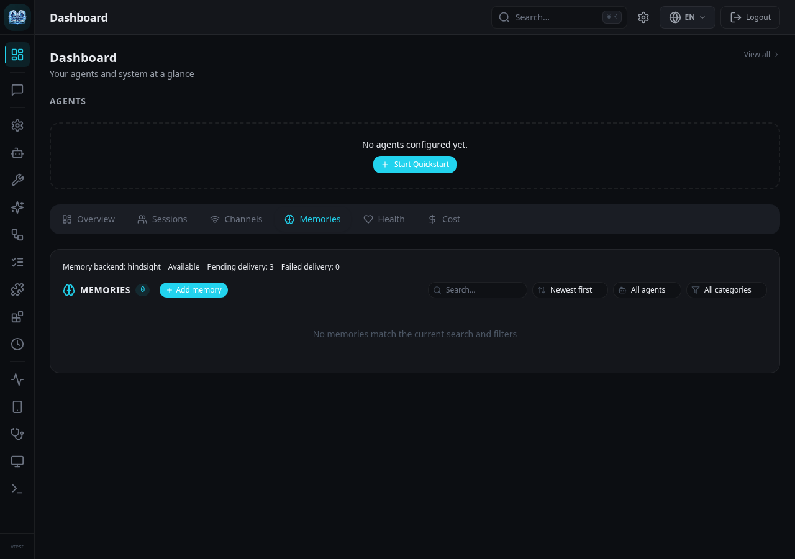

# Hindsight long-term memory

Hindsight is an opt-in, exclusive long-term-memory backend. The SQLite native
conversation archive remains the canonical transcript. The rolling summary deck
continues to manage active context independently. Enabling Hindsight does not
convert, rewrite, or delete either of those stores.

This integration is fork-specific. It deliberately selects Hindsight as the
long-term-memory authority; it is not an enrichment connector that also writes
SQLite memories. Upstream adoption needs review against
[ADR-010](../architecture/decisions/ADR-010-memory-authority-boundaries.md).

## Data flow and ownership

1. Native session admission registers a delivery cursor before execution starts.
2. The existing native engine commits the user input and final assistant response.
3. A background worker advances bounded, indexed event pages and durably enqueues
   transcript references. It reads original inputs, admitted steering messages,
   and committed final output,
   not the provider prompt or its injected memories.
4. Hindsight extracts facts and performs its native observation consolidation.
5. Before a normal conversational response, the shared memory-injection path
   retrieves evidence using the question and bounded immediate chat context.
   Adaptive reflection routes deeper historical questions through Hindsight.
6. Retrieved evidence uses the existing structured, retained memory blocks. It is
   not ingested again as new source material.

`<data_dir>/hindsight/delivery.db` holds agent/bank identities, transcript cursors,
operation UUIDs, ingestion status, erasure frontiers, and backfill intents. It has
no vectors, memory-search implementation, or substitute recall path. Standalone
explicit notes additionally spool their screened delivery body until extraction
completes, because they need not have a corresponding conversation record. That
body is removed on completion. Ordinary conversational jobs store references only. Keyed
note edits are delivered in their accepted order, so an older outage retry cannot
overtake a newer edit. Repeating a pending latest value reuses its operation. A fresh write after
completion, or a change back to an earlier value, creates a new delivery intent;
a completed receipt is not treated as proof that UI-managed content still exists.

The worker commits its operation UUID before HTTP submission. Uncertain responses
are reconciled against that UUID; a missing operation can be resubmitted with the
same ID. HTTP acceptance is not counted as completed retention. Failed jobs retain
backoff and diagnostics. At capacity, the durable source cursor stays behind the
archive instead of discarding turns or delaying a completed reply.

A bank is scoped by a persistent agent UUID, principal, namespace, and tenant.
Session IDs are provenance, not observation-isolation tags. Explicit personal
connection bindings in `agent.main_session` can join the operator's bank across
Web, Telegram, and SimpleX. Other admitted channel peers get separate identities.
Removing a binding or disabling an agent is checked through live policy. Tools
cannot select arbitrary banks. RPC callers use their own private plane; Hindsight
has no shared-plane override. Paired dashboard routes use the installation operator.

Tool output, system prompts, summaries, and hidden reasoning are excluded from
automatic retention. ACP/Code sessions remain isolated from automatic memory capture and injection.
Internal delegation, cron, and daemon turns are not treated
as new user-authored conversations. Explicit memory notes remain possible.
Recognized credentials are redacted using the existing secret redactor; ordinary
memory scanning, namespace policy, and optional audit also apply.

A changed native erasure frontier blocks retrieval until retained source
references have been checked again. A removed source document is deleted through
Hindsight, including its derived memory links/observations. An in-flight retain is
allowed to reach its terminal state before document deletion, avoiding the race
where a cooperatively cancelled worker writes facts after deletion. The bank stays
blocked during that reconciliation. Erasure does not fall back to SQLite recall.

The dashboard's Memories tab reports the selected backend and delivery health.
This example uses synthetic queue values and no private memory content:



## Explicit provisioning

Requirements: Python 3.12, `uv`, the Hugging Face `hf` CLI, a supported Linux
runtime for pg0, and sufficient RAM/disk for the model caches. No GPU is required
for the verified CPU configuration.

Run the explicit provisioner:

```sh
./dev/setup-hindsight.sh /srv/zeroclaw-hindsight
```

Choose a directory writable by your service user. The default, when no argument
is supplied, is `$XDG_DATA_HOME/zeroclaw/hindsight` or
`$HOME/.local/share/zeroclaw/hindsight`.

The script pins `hindsight-embed==1.2.0`, `hindsight-api==1.2.0`, pg0 0.16.1,
CPU PyTorch 2.15.0, and tested inference-library versions in separate API and
decision virtual environments. It downloads these immutable model revisions:

| Component | Model | Revision |
| --- | --- | --- |
| Embeddings | `hindsight-ai/hs-embed-1` | `3164caa4db95a03faac8a327f914f7c8f42d2f98` |
| Ordinary reranking | `hindsight-ai/hs-rerank-1` | `927f5be31280298a51cf29af8a29cb111ed812c5` |
| Decisions | `hindsight-ai/hs-decide-1-flash` | `e2c789026dfd1f7608cafb2ef6a9bb31397af802` |

Runtime startup uses cached models and offline mode. Missing packages or weights
are an actionable startup failure, not an implicit download or hosted fallback.

## Optional Hindsight web interface

The official Control Plane can inspect banks, facts, source documents,
observations, mental models, and retrieval results. Provision its pinned package
alongside the API, without replacing embedded PostgreSQL:

```sh
ZEROCLAW_HINDSIGHT_WITH_UI=1 ./dev/setup-hindsight.sh /srv/zeroclaw-hindsight
/srv/zeroclaw-hindsight/control-plane/node_modules/.bin/hindsight-control-plane \
  --hostname 127.0.0.1 --port 9999 --api-url http://127.0.0.1:9077
```

The UI is a separately running upstream component. Bind it to loopback and use
an authenticated private tunnel or SSH forwarding for remote access. It exposes
memory-management authority over the connected local API, not ZeroClaw's
per-principal tool interface. Do not expose it as a public dashboard or give
unrelated users access. `HINDSIGHT_CP_ACCESS_KEY` can additionally protect the UI;
store it in a protected service environment file, not command arguments.

ZeroClaw owns backend selection, principal/bank bindings, ingestion policy, and
managed-process provider credentials. Hindsight owns bank missions and stored
memory content. The integration does not overwrite bank missions on every turn.
Change bank retain/observation/reflection missions in Hindsight's Configuration
tab; change process/provider settings through ZeroClaw and reload its daemon.
Explicit mental models declared in ZeroClaw remain configuration-managed; create
additional UI-owned models outside those declared IDs.

If Hindsight's own UI/manager should own process-wide provider settings as well,
choose `mode = "external"` and let that manager supervise the API. Automatic
retention, recall, reflection, and ZeroClaw bank authorization still operate.
Avoid having ZeroClaw and the Control Center both supervise or rewrite the same
managed profile. Managed mode remains the recommended initial setup here.

First-person extraction guidance is already enabled. `IDENTITY.md` and `USER.md`
are not automatically copied into Hindsight missions. A future identity bridge
must resolve the current canonical files, screen and bound the selected text,
and restrict user-profile context to that user's authorized bank. Identity context
must guide interpretation without being retained as a new conversation, and
must preserve speaker attribution rather than rewriting user decisions as the
agent's own actions. Do not copy the full system prompt or hidden reasoning.

## Separate decision server

The decision model is not an in-process feature of `hindsight-embed`. The
provisioner installs the official model repository's serving package and writes a
small launcher that reads its key from a mode-0600 file. The key is not placed in
the operating-system command line. It binds to `127.0.0.1:8000` and provides the
required `/v1/systemone` protocol.

For a user service, save the following as
`~/.config/systemd/user/zeroclaw-hindsight-decision.service`, adapting both absolute
paths to the provisioned directory:

```ini
[Unit]
Description=Hindsight local CPU decision model

[Service]
Type=simple
ExecStart=/srv/zeroclaw-hindsight/decision-runtime/bin/python /srv/zeroclaw-hindsight/serve-decision.py
Environment=HF_HUB_OFFLINE=1
Environment=CUDA_VISIBLE_DEVICES=
Environment=HIP_VISIBLE_DEVICES=
Environment=OMP_NUM_THREADS=4
Environment=MKL_NUM_THREADS=4
Restart=on-failure
RestartSec=5

[Install]
WantedBy=default.target
```

```sh
systemctl --user daemon-reload
systemctl --user enable --now zeroclaw-hindsight-decision.service
```

The CPU Transformers server is an official upstream implementation of the decision
protocol. For vLLM, use the serving plugin documented in the
[model repository](https://huggingface.co/hindsight-ai/hs-decide-1-flash).
Stock vLLM's OpenAI endpoint does not implement `/v1/systemone`. This fork has not
validated the vLLM plugin on ROCm or the host AMD GPU. Do not change drivers,
reallocate another service's GPU, or claim GPU support based on the CPU tests.

## Configuration

Adapt this example to existing agent/provider aliases. Do not duplicate credentials
from an existing provider; `credential_provider` resolves its decrypted API key at
use time and does not change the conversational model, routes, or summary provider.

```toml
[memory]
backend = "hindsight"
rerank_enabled = false
consolidation_extract_facts = false

[memory.types]
enabled = false

[knowledge]
enabled = false

[channels]
session_persistence = true
session_backend = "sqlite"

[agents.assistant.memory]
backend = "hindsight"

[memory.hindsight]
mode = "managed"
api_url = "http://127.0.0.1:9077"
bank_template = "zeroclaw-{agent}"
startup_timeout_secs = 120
request_timeout_secs = 15
reflect_timeout_secs = 120
retain_async = true
retry_failed_retains = true
queue_capacity = 10000
auto_retain = true
auto_recall = true
auto_reflect = true
reflect_mode = "adaptive"
recall_budget = "mid"
recall_max_tokens = 2048
reflect_budget = "mid"
prefer_observations = true

[memory.hindsight.runtime]
binary_path = "/srv/zeroclaw-hindsight/runtime/bin/hindsight-embed"
data_dir = "/srv/zeroclaw-hindsight"
package_version = "1.2.0"

[memory.hindsight.models]
embedding = "hindsight-ai/hs-embed-1"
reranker = "hindsight-ai/hs-rerank-1"
decision = "hs-decide-1-flash"
decision_enabled = true
decision_endpoint = "http://127.0.0.1:8000"
decision_recall_rerank = false

[memory.hindsight.llm]
provider = "minimax"
model = "MiniMax-M3"
credential_provider = "minimax.default"
```

Every configured agent must explicitly select `hindsight` or `none`, including
worker profiles. Validation rejects competing SQLite memory, local extraction,
local reranking, built-in knowledge-graph processing, and cross-agent shared-memory
grants. These restrictions do not disable the SQLite transcript or summary deck.

`llm.provider` follows upstream Hindsight provider names. For a custom
OpenAI-compatible server use `provider = "openai"`, its model, and an explicit
`base_url`. A direct `api_key` uses ZeroClaw's existing encrypted-secret handling.
Alternatively, `runtime.env_file` can identify an owner-only protected file of
supported `HINDSIGHT_API_*_LLM_{PROVIDER,MODEL,BASE_URL,API_KEY}` settings. This file
cannot override listeners, executables, or the database. Do not combine a direct
key and a credential-provider reference.

Per-operation overrides use the same LLM structure:

```toml
[memory.hindsight.llm_overrides.reflect]
provider = "openai"
model = "your-reflection-model"
credential_provider = "openai.default"
```

Supported operation names are `retain`, `reflect`, `consolidation`, and
`mental_model_refresh`. Newly authored extraction uses the shared first-person
memory guidance; original quoted source material is unchanged.

Run `zeroclaw memory setup` to write the official protected embed profile. Reload
the ZeroClaw daemon to apply backend changes. Managed mode verifies the installed
Python distribution versions, locks dedicated ownership, uses the official daemon
manager, checks health, and supervises subsequent restarts through that manager.
An initial startup failure leaves memory degraded and requires a daemon reload
after its reported cause is corrected. It records
which environment was actually started. Changed settings cannot silently continue
using an old managed configuration. Managed shutdown stops only its own profile.

For an independently operated Hindsight service, select `mode = "external"`.
ZeroClaw then neither starts nor stops that service. External TLS endpoints are
supported. Managed API binding is literal loopback HTTP; expose a proxy only as an
explicit operator decision. A failed Hindsight service never selects another
long-term-memory backend.

## Reflection and mental models

`reflect_mode` supports `off`, `adaptive`, and `always`. Adaptive routing uses the
current question, not phrases in unrelated retrieved context. It recognizes
historical decisions, reasons, evolution, earlier discussion, and cross-conversation
synthesis. Trivial conversation uses ordinary recall. Explicit `hindsight_recall`,
`hindsight_reflect`, and `hindsight_retain` use the same scoped, screened binding.
Disabling automatic recall does not disable those tools.

Only explicitly configured mental models are initialized:

```toml
[memory.hindsight.mental_models.project-architecture]
name = "Project architecture"
source_query = "What durable architectural decisions and constraints have we established?"
max_tokens = 2048
min_refresh_interval_seconds = 3600
```

Their native trigger uses `refresh_after_consolidation = true`. These are durable
knowledge pages, not rolling context summaries. Do not create a mental model per
turn or session. `decision_recall_rerank = true` changes upstream recall ordering to
the decision model; it does not add another Rust reranker after Hindsight.

## Status, recovery, and historical import

```sh
zeroclaw memory status
zeroclaw memory health
zeroclaw memory retry-pending
zeroclaw memory list --agent assistant
zeroclaw memory get MEMORY_ID --agent assistant
zeroclaw memory backfill --agent assistant --session CONVERSATION_ID
zeroclaw memory backfill --agent assistant --since 2026-01-01T00:00:00Z --until 2026-02-01T00:00:00Z
```

Status reports API/database readiness, configured models, decision-server health,
managed-configuration application, banks, queue counts, backfill backlog, last
successful retention/recall/reflection, recent stable error keys, and durations.
It excludes credentials and memory text. The paired dashboard uses the same
backend for memory browsing/search and exposes `/api/memory/status`.

Historical backfill is explicit and resumable. It uses canonical native completed
turns, original timestamps, stable document IDs, and independent import cursors.
Date bounds select turn-completion timestamps. Replaying the same import does not
rewind live capture or create another retention operation for an existing source.
An unattributed source requires an explicit operator principal and still cannot
bypass source ownership checks. No historical import starts merely by enabling
Hindsight.

Native source erasure deletes retained documents. Forgetting a fact by its memory
UUID instead uses Hindsight's reversible invalidation, which prunes its derived
observations and excludes it from recall. A standalone keyed note can be removed
by deleting its deterministic source document.

If Hindsight is down, chat continues from session context and rolling summaries;
recall failure is recorded, and retained turns remain pending in the delivery
ledger. Restore the service, inspect health, then retry pending work. Do not remove
the ledger to clear an error: it owns idempotency and bank identity.

## Backups and re-embedding

Back up the canonical SQLite archive separately using its existing backup
procedure. Also preserve the Hindsight pg0 state directory, delivery ledger, and
protected profile/decision credentials. For a cold filesystem backup, stop the
ZeroClaw daemon, stop its dedicated API through `hindsight-embed -p PROFILE daemon
stop`, then stop that dedicated database with the official
`PG0_HOME=/srv/zeroclaw-hindsight/pg0 /srv/zeroclaw-hindsight/runtime/bin/pg0 stop --name PROFILE`
(adapt the configured runtime directory). Copy closed data files, not a live PostgreSQL data directory. Restore
PostgreSQL and the delivery ledger from a consistent point. Keep all backups
private. A restored archive can explicitly backfill missing memory sources.

Hindsight 1.2 has no public bank-wide re-embedding endpoint. `zeroclaw memory
reindex` therefore reports an explicit unsupported operation instead of claiming
that zero entries were successfully rebuilt. For an existing document, the
supported upstream operation is:

```text
POST /v1/default/banks/{bank_id}/documents/{document_id}/reprocess
```

It re-runs extraction with current engine settings and replaces that document's
facts. It is not an atomic embedding-dimension migration. For an embedding model
or dimension change, back up and stop the old service, provision a fresh dedicated
Hindsight data directory, archive the closed delivery ledger, and explicitly
backfill the canonical SQLite archive into the new installation. Never delete or
rewrite the conversation archive. Do not mix old/new embedding dimensions in a
populated bank or silently reuse completed-delivery bookkeeping against an empty
new database.

## Validation and remaining limits

The integration includes mock transport/security tests, durable ledger tests, and
opt-in tests against a real local service:

```sh
cargo test -p zeroclaw-config --lib hindsight
cargo test -p zeroclaw-memory --lib hindsight
cargo test -p zeroclaw-session-host --lib hindsight
ZEROCLAW_TEST_HINDSIGHT_URL=http://127.0.0.1:9077 cargo test -p zeroclaw-memory --lib real_local_retain -- --ignored
ZEROCLAW_TEST_HINDSIGHT_URL=http://127.0.0.1:9077 cargo test -p zeroclaw-session-host --lib real_completed_turn -- --ignored
```

The real tests require all provisioned components and an independently configured
generative LLM. They create isolated fixture banks and exercise native turn
commit, automatic retention, observation consolidation, recall, reflection,
principal isolation, and source-erasure propagation. They must not be reported as
passed when those services are absent.

Known limitations requiring further work or operator handling:

- Backfill currently handles native completed turns. Older imported legacy
  snapshots without recorded turn/owner provenance are not guessed into a bank.
- Bulk re-embedding/dimension migration requires the explicit upstream procedure
  above; the CLI does not invent an unsupported Hindsight API.
- Per-agent alias renaming and bulk principal/namespace purge are not implemented
  for Hindsight; unsupported operations fail explicitly.
- Backfill merges source event-time frontiers across sessions and resumes after
  backpressure. Full restart/fault-injection coverage still needs expansion.
- CPU decision serving and decision-reranked recall are verified. A three-query
  fixture measured ordinary recall at 32–90 ms and decision recall at roughly
  1.5 seconds. This is a latency smoke test, not a retrieval-quality evaluation;
  ordinary reranking remains the default. vLLM/ROCm serving is unverified.

See upstream [installation](https://hindsight.vectorize.io/developer/installation),
[embed runtime](https://hindsight.vectorize.io/sdks/embed),
[models](https://hindsight.vectorize.io/developer/models), and
[decision models](https://hindsight.vectorize.io/developer/decision-models).
